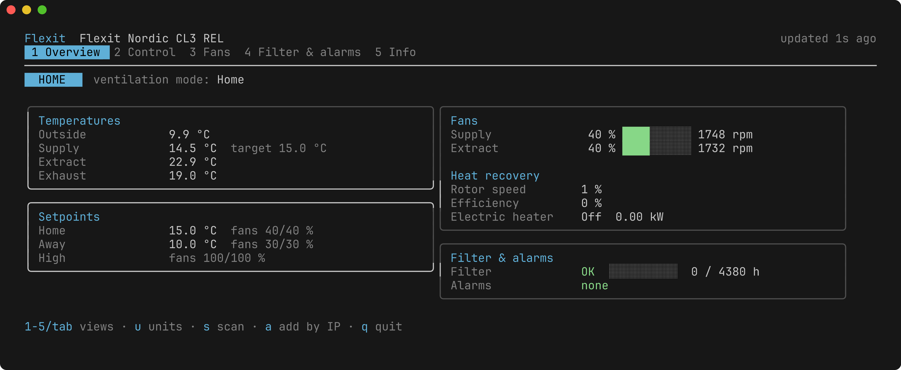

# flexit-tui

A terminal app for monitoring and controlling Flexit Nordic ventilation units
on your home network.



## Install

### Flatpak

Download the bundle for your architecture from the
[latest release](https://github.com/oskarkook/flexit-tui/releases/latest)
(`flexit-<version>-linux-x86_64.flatpak` or `...-aarch64.flatpak`) and install
it:

```sh
flatpak install ./flexit-<version>-linux-x86_64.flatpak
flatpak run io.github.oskarkook.FlexitTui
```

The bundle uses the Freedesktop runtime from Flathub. If you don't have the
Flathub remote configured:

```sh
flatpak remote-add --if-not-exists flathub https://flathub.org/repo/flathub.flatpakrepo
```

### Binary

Prebuilt binaries for Linux, macOS and Windows are attached to each release.
